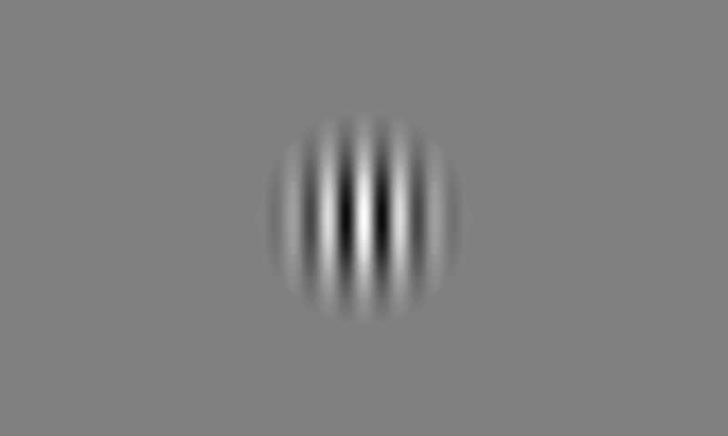

# Visual cue Pavlovian task

고정된 쥐에게 Raspberry Pi 4B의 7인치 화면으로 Gabor 자극을 제시하고, Arduino Uno로 보상 밸브와 lick 센서를 제어합니다. Python 프로그램은 화면과 기록을 담당하고, Arduino는 기존 배선에서 밸브·센서·TTL을 담당합니다. 두 장치는 USB로 연결합니다.

처음 설치할 때는 [Raspberry Pi 설치·실행 안내](docs/raspberry_pi.md)를 따라 진행하세요. 클라우드에서 만드는 파일을 실제 Raspberry Pi에 복사하고, 새 Arduino 스케치를 실제 Uno에 업로드해야 장치에서 실행됩니다.

## 실험 동작

대기·시행 사이·실험 종료 후에는 회색 화면이 유지됩니다. 자극은 화면 정중앙(가로 50%, 세로 50%)에 놓인 원형 Gabor 패치이며, 흑백 줄무늬가 공간상으로 번갈아 배치된 **정지 무늬**입니다. 움직임이나 깜빡임은 없습니다. 가장자리는 Gaussian 형태로 회색 배경에 부드럽게 섞입니다.

기본 세션은 100회이며 모든 시행에서 보상을 제공합니다. 세션 시작 시 기존 코드와 같은 LED/TTL 시작 신호를 보낸 뒤 최초 대기 90초가 시작됩니다. 이후 각 시행의 시간표는 다음과 같습니다.

| 시행 시작 기준 | 화면 및 장치 동작 |
|---|---|
| 0초 | 시행 시작, 회색 화면 |
| 0.9초 | D7 cue 사전 트리거 20ms |
| 1초 | 화면 정중앙에 Gabor 자극 표시 |
| 3초 | 자극 종료, 회색 화면 복귀 |
| 5.9초 | D7 reward 사전 트리거 20ms |
| 6초 | 자극 종료 예정 시점에서 3초 후, 보상 밸브 30ms 개방 |
| 10초 | 보상 시작 후 4초 측정 구간 종료, 시행 종료 |
| 10초 이후 | 회색 화면에서 ITI 10–20초 (감소하는 지수분포) |
| 20–30초 | 다음 시행 시작 |

ITI는 **시행 종료부터 다음 시행 시작까지**의 시간이며, 기본값은 10–20초의 정수 초를 감소하는 지수분포로 선택합니다. 연속 시행의 시작 간격은 20–30초입니다. 마지막 시행은 10초의 측정 구간까지 마친 뒤 세션을 종료합니다. 보상 밸브의 30ms는 보상 부피가 아니므로 실제 장치에서 양을 측정해야 합니다.

Lick은 D11의 LOW→HIGH 전환으로 감지하고, 직전 감지 이후 50ms 미만의 신호는 제외합니다. 감지할 때마다 터미널에 `LICK: 1`, `LICK: 2`처럼 누적 횟수를 즉시 표시하고, `events.csv`에도 시각과 누적 횟수를 저장합니다. 시행 중과 ITI를 포함해 세션 전체에서 기록하며, 보상 뒤 4초 측정 구간도 포함합니다. **Lick 여부는 보상 제공이나 다음 시행 시작을 지연시키지 않습니다.** 고정된 시간표를 따르도록 기존 코드의 보상 후 lick 대기 조건을 제거했습니다.

자극 무늬의 예시입니다. 현재 실행 시 위치는 화면 정중앙입니다. 실제 픽셀 크기는 `diameter_px` 설정으로 바뀝니다.



## 기존 배선

| Uno 핀 | 장치 | 이 코드에서의 용도 |
|---|---|---|
| D6 | 부저 | 소리 자극 없이 LOW 유지 |
| D12 | 보상 밸브 제어 회로 | 보상 때 HIGH |
| D11 | Lick 센서 | 입력, HIGH가 감지 상태 |
| D10 | LED | 세션 시작 신호 |
| D9 | TTL 출력 | 세션 시작·cue·보상 표시 |
| D7 | pyPhotometry 공통 이벤트 출력 | cue 요청·밸브 개방 명령 각각 100ms 전, 20ms HIGH |
| D8 | 미사용 | LOW 유지, 연결하지 않음 |

밸브는 기존 연구실의 구동 회로를 통해 제어합니다. Pi와 Uno 사이 통신은 USB이며, Pi GPIO를 사용하지 않습니다. D9는 Uno의 5V 신호이므로 Pi의 3.3V GPIO에 바로 연결하면 안 됩니다.

**pyPhotometry 연결:** D7은 Uno의 약 5V 출력입니다. 전압 변환을 거쳐 Digital 1의 Signal에, Uno GND는 Digital 1의 GND에 연결하세요. cue와 reward 펄스가 한 채널로 들어가 같은 event-triggered 평균에 함께 반영됩니다. [배선도·GUI 사용·트리거 설정](docs/pyphotometry.md)에 연결 방법을 정리했습니다. 기본 설정은 두 이벤트 각각 100ms 전, 폭 20ms이며, 새 기능을 사용하려면 Uno 스케치를 다시 업로드해야 합니다. 논문 버전 GUI의 event-triggered 평균은 Digital 1의 상승 에지 기준입니다.

## 빠른 실행

**pyPhotometry TTL만 시험:** 최신 Uno 스케치를 업로드한 뒤 `python3 test_ttl.py --port /dev/ttyACM0`을 실행하면 D7에서만 20ms 펄스를 10초 간격으로 5번 보냅니다. 행동 프로그램은 종료하고 pyPhotometry 수집을 먼저 시작하세요. [단독 시험 안내](docs/pyphotometry.md#d7-ttl만-단독-시험하기)를 참고하세요.

Python 3.10 이상과 [requirements.txt](requirements.txt)의 패키지가 필요합니다. 아래 명령은 저장소 폴더에서 실행합니다.

```bash
python3 -m venv .venv
source .venv/bin/activate
python -m pip install -r requirements.txt
```

**장치 연결 전 화면 시험:** 다음 명령은 Arduino 없이 가상 세션을 3회만 실행합니다. 회색 창과 자극이 보이는지, 기록 파일이 만들어지는지 확인하는 용도입니다. 실제 밸브는 움직이지 않습니다. `--windowed`는 작은 창으로 표시하고, `--autostart`는 Space 입력 없이 시작하며, `--exit-when-done`은 완료 후 창을 닫습니다.

```bash
python HEADFIXED_PYTHON.py --simulate --demo --windowed --autostart --exit-when-done
```

**실제 실험:** 코드를 Raspberry Pi에 복사하고 새 스케치를 Uno에 업로드한 뒤, Pi에서 아래 한 줄을 실행합니다. `/dev/ttyACM0`은 Pi에 USB로 연결된 Uno의 포트이고 `mouse01`은 기록 파일에 붙일 개체 이름입니다. 회색 화면이 열리면 Space를 눌러 100회 세션을 시작합니다. 시행표는 프로그램이 자동으로 만들고 해당 세션의 기록 폴더에 저장합니다.

```bash
python HEADFIXED_PYTHON.py --port /dev/ttyACM0 --mouse-id mouse01
```

**시행표를 따로 만들고 싶을 때만:** 여러 개체에 정확히 같은 시행표를 지정하려면 다음 두 명령을 사용합니다. 첫 줄은 CSV 파일을 만들고, 둘째 줄의 `--schedule`은 그 파일을 읽습니다. 같은 파일 이름이 이미 있으면 덮어쓰지 않고 오류가 납니다. 기본 ITI는 10–20초의 지수분포이며 100회 모두 보상합니다. 같은 설정과 `--seed`를 사용하면 같은 ITI 순서를 재현합니다. 기존 33초 ITI 시행표는 새 범위를 벗어나므로 다시 생성하세요.

```bash
python generate_schedule.py --seed 123 --out schedules/today.csv
python HEADFIXED_PYTHON.py --port /dev/ttyACM0 --mouse-id mouse01 --schedule schedules/today.csv
```

`raspberry_pi.py`도 같은 실행 옵션을 받습니다. USB 포트 이름은 장치에 따라 다르며 [Pi 안내](docs/raspberry_pi.md#usb-포트-확인)에서 확인할 수 있습니다.

| 키 | 동작 |
|---|---|
| Space | 준비된 세션 시작 |
| Esc | 실험 중단, 밸브 닫기 및 회색 화면 복귀 |
| Q | 프로그램 종료 |

동물에게 보이는 화면에는 상태 글씨나 버튼을 표시하지 않습니다. 준비 상태·시행 진행·오류는 실행한 터미널에서 확인합니다. 정상 종료 뒤에도 회색 화면이 유지되며 Q로 닫습니다. 다음 세션은 프로그램을 다시 실행해 시작합니다.

## 자극과 실험 조건 바꾸기

[config/experiment.json](config/experiment.json)을 편집해 다음 실행에 적용합니다. 파일을 복사해 조건별 설정을 보관할 수도 있습니다.

```bash
python HEADFIXED_PYTHON.py --config config/experiment.json --port /dev/ttyACM0 --mouse-id mouse01
```

| `stimulus` 설정 | 기본값 | 의미 |
|---|---:|---|
| `diameter_px` | 276 | 원형 패치 지름, 화면 픽셀 단위 |
| `cycles_per_patch` | 6 | 패치 지름 안의 흑백 줄무늬 주기 수 (아래 화면 가정에서 약 0.4 cycle/degree) |
| `orientation_deg` | 45 | 0도는 세로 줄무늬 |
| `contrast` | 1.0 | 대비, 0은 배경만 보이고 1은 최대 |
| `sigma_fraction` | 0.29578217 | Gaussian 표준편차를 패치 지름으로 나눈 값 (아래 화면 가정에서 FWHM 약 10.5°) |
| `phase_deg` | 0 | 줄무늬의 시작 위치 |

검은 줄 하나와 흰 줄 하나가 한 주기입니다. 지름이 240px일 때 6주기는 한 주기당 40px입니다. `cycles_per_patch`를 12로 바꾸면 줄무늬가 두 배 촘촘해집니다. 패치 크기를 바꿔도 줄무늬 간격을 유지하려면 주기 수도 같은 비율로 바꾸세요. 예를 들어 **240px·6주기 → 360px·9주기**입니다.

현재 공간주파수는 `cycles_per_patch / diameter_px`인 cycles/pixel로 결정합니다. 신경과학에서 쓰는 cycles/degree로 맞추려면 실제 화면의 가로 길이, 해상도, 쥐 눈과 화면 사이의 거리가 필요합니다. 7인치라는 정보만으로 시각도 단위를 정하지 않습니다.

현재 지름 276px은 7인치 대각선·800×480 해상도·정사각형 픽셀을 가정한 근삿값입니다. 눈이 패치 중심을 정면으로 바라보고 중심까지 거리가 20cm라면, 지름 시야각 15°에 필요한 물리적 크기는 `2 × 20 × tan(7.5°) ≈ 5.27cm`입니다. 위 가정에서 화면 가로는 약 15.25cm이고, 필요한 지름 약 276.32px을 정수 276px로 반올림했습니다. 실제 표시 영역 치수나 픽셀 종횡비가 다르면 다시 보정해야 합니다. 15°는 원형 패치 경계의 지름 기준이며 Gaussian으로 희미해지는 무늬의 가시 범위와는 다릅니다. 화면 정중앙에 배치하며, 800×480 화면에서 중심은 (400, 240)입니다.

이 화면 가정과 거리 20cm에서 `cycles_per_patch = 6`은 약 15° 지름에 여섯 주기, 즉 평균 약 0.4 cycle/degree에 해당합니다. `sigma_fraction = 0.29578217`을 유지하므로 지름 276px에서 `sigma ≈ 81.64px`입니다. Gaussian의 `FWHM = 2 × sqrt(2 × ln(2)) × sigma`에 따라 반치전폭은 약 192.24px, 시야각 약 10.5°입니다. FWHM은 줄무늬 자체의 밝기 폭이 아닌 Gaussian 대비 포락선의 반치전폭입니다. 바깥쪽 경계의 taper는 반치점 밖에서 적용됩니다. 물리적 화면 치수나 거리를 바꾸면 다시 보정해야 합니다.

`display.background_gray`의 기본값은 128이며 범위는 0–255입니다. 전체 화면 모드에서는 실제 화면 크기를 사용합니다. `window_width`, `window_height`는 창 모드에서의 크기이며, 패치는 화면에 들어가는 크기로 설정해야 합니다.

| `session` 설정 | 기본값 | 의미 |
|---|---:|---|
| `trials` | 100 | 시행 횟수 |
| `cue_delay_ms` | 1000 | 시행 시작에서 자극 시작까지 |
| `cue_duration_ms` | 2000 | 자극 표시 시간 |
| `reward_at_ms` | 6000 | 시행 시작에서 보상 시작까지 |
| `valve_open_ms` | 30 | 밸브 개방 시간 |
| `post_reward_ms` | 4000 | 보상 시작부터 시행 종료까지의 측정 시간 |
| `initial_iti_s` | 90 | 시작 신호 뒤 최초 시행까지의 대기 |
| `iti_min_s`, `iti_max_s` | 10, 20 | 시행 종료 뒤 ITI의 최소·최대 초 (양 끝 포함) |
| `iti_distribution` | exponential | `exponential`: 감소하는 지수분포, `uniform`: 균등분포 |
| `iti_exponential_scale_s` | 3.0 | 지수분포의 시간 상수(초). 작을수록 최소 ITI에 집중 |
| `seed` | null | 시행표 난수 초기값, null은 자동 생성 |

`_ms`는 밀리초, `_s`는 초 단위입니다. 기본값은 10–20초의 각 정수 `t`에 확률 가중치 `exp(-(t - 10) / 3)`을 주고 범위 안에서 추출합니다. 10초가 가장 흔하고, 20초 쪽으로 갈수록 드물어집니다. 20초 초과 표본을 20초로 잘라 붙이지 않습니다. 유한한 시행표의 빈도가 매번 정확히 감소하는 것은 아닙니다. `iti_distribution`을 생략한 기존 설정은 균등분포를 사용합니다. 두 경계를 같게 설정하면 고정 ITI입니다. 최초 대기 `initial_iti_s`(90초)는 이 분포와 별도입니다. 시간 설정이나 시행 수를 바꿨다면 새 조건으로 시행표를 다시 생성하세요.

## 기록 및 시간 기준

실행마다 `data/` 아래 별도의 세션 폴더를 생성하고 `events.csv`, `schedule.csv`, `metadata.json`을 저장합니다. `--outdir`로 저장 위치를 변경할 수 있습니다. 사용한 설정과 시행표를 함께 보관해 실험 조건을 추적할 수 있습니다.

화면 전환을 요청한 Python 시간과 Arduino 이벤트 시간을 함께 기록합니다. Python의 일반 시각에는 시간대가 포함되며, 간격 계산에는 별도의 단조 증가 시계를 사용합니다. Arduino 시간은 보드 시작 이후의 `millis()`입니다. 서로 다른 시계를 보정 없이 직접 빼면 안 됩니다.

D9의 cue TTL은 화면 갱신 뒤 Pi가 보낸 확인 메시지를 Uno가 수신한 시점을 표시합니다. D7의 공통 사전 트리거는 예정된 이벤트보다 먼저 나오는 별도 신호입니다. 화면에서 실제 빛이 바뀌는 시점과는 디스플레이 갱신·USB 통신 지연만큼 차이가 날 수 있습니다. DA 신호와 자극의 정확한 동기화가 필요하면 포토다이오드와 실제 기록 장비로 지연을 측정하세요. 이 프로그램 자체에는 DA 기록 장비를 제어하거나 DA 데이터를 수집하는 기능이 없습니다.

## 파일 구성

| 경로 | 내용 |
|---|---|
| `HEADFIXED_PYTHON.py`, `raspberry_pi.py` | Pi 실행 진입점 |
| `visualcue/` | 화면, 시행표, 통신, 기록 처리 |
| `arduino/HEADFIXED_ARDUINO/HEADFIXED_ARDUINO.ino` | Uno에 올릴 새 스케치 |
| `generate_schedule.py` | 재사용할 시행표 생성 |
| `config/experiment.json` | 실험과 화면 설정 |
| `reference/` | 연구실에서 가져온 원본 코드 |
| `tests/` | 하드웨어 없이 수행하는 검사 |

실제 센서의 극성, 밸브 구동 및 화면의 밝기·지연은 실제 장치에서 확인해야 합니다. 처음에는 동물 없이 화면, lick 입력, 밸브 작동을 확인하세요. 수동 물 공급 점검은 별도 프로그램 `prime_valve.py`로 수행합니다. **최신 Uno 스케치를 다시 업로드한 뒤** [밸브 점검 안내](docs/valve_test.md)에 따라 계속 열기 또는 반복 여닫기를 선택하세요.

Pi에 키보드가 없다면 `--autostart`로 실제 실험도 Space 없이 시작할 수 있습니다. 실제 보상이 제공되며, SSH 터미널의 Ctrl+C로 중단합니다. Pi 화면 지정과 실행 명령은 [SSH 실행 안내](docs/raspberry_pi.md#pi-키보드-없이-ssh에서-시작)를 참고하세요.

## 검증 명령과 한계

저장소 폴더에서 Python 검사와 실제 스케치의 상태 전이 검사를 실행할 수 있습니다. 두 번째 명령에는 C++ 컴파일러(`g++` 등)가 필요합니다. C++ 검사는 실제 `.ino`를 가상 Arduino 입출력과 함께 컴파일하며, 물리적인 전압·USB·화면 지연을 재현하지 않습니다.

```bash
python -m unittest discover -s tests -v
bash tests/run_firmware_tests.sh
```

자극 표시 확인이 요청 후 100ms 이상 늦거나, 자극 종료 확인이 없거나, 통신이 끊기면 Arduino가 출력을 닫고 중단합니다. Python도 자극 지속 시간이 설정값보다 `display.max_cue_overrun_ms`(기본 100ms) 이상 길어지면 중단합니다. 따라서 화면 전환 지연이 큰 장치에서 실패한 세션을 정상 실험으로 기록하지 않습니다. 이 한계 안에서도 실제 빛의 시작 시각은 별도 측정해야 합니다.

클라우드에서 Uno 컴파일, 모의 화면·CSV 흐름, 전체 100회 스케치 동작을 검사했습니다. Raspberry Pi 디스플레이와 실제 보드 연결은 아직 검증하지 않았습니다.
